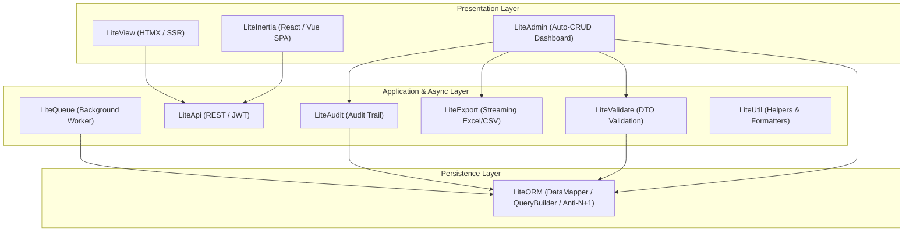

# LitePlatform

**Sovereign, High-Performance, Zero-External-Dependency Full-Stack PHP 8.2+ Ecosystem.**

Designed as a modern, unbloated alternative to monolithic PHP frameworks (e.g. Laravel) and legacy CMSs (e.g. WordPress, Joomla). Provides an entire full-stack suite consuming **< 16MB RAM** with **100% PSR compliance** (PSR-7, PSR-11, PSR-15).

---

## 🏛️ Ecosystem Overview (10 Sovereign Libraries)

| Package | GitHub Repository | Packagist | Description |
| :--- | :--- | :--- | :--- |
| **`LiteORM`** | [kzxl/LiteORM](https://github.com/kzxl/LiteORM) | `kzxl/lite-orm` | High-performance Micro-ORM, Unit of Work, Dirty Checking, LINQ-style syntax & **Batch Eager Loading** (`with()`). |
| **`LiteQueue`** | [kzxl/LiteQueue](https://github.com/kzxl/LiteQueue) | `kzxl/lite-queue` | Zero-dependency Background Job Queue & Worker with **ACID Atomic Locking** on SQLite/MySQL, retries & DLQ. |
| **`LiteAdmin`** | [kzxl/LiteAdmin](https://github.com/kzxl/LiteAdmin) | `kzxl/lite-admin` | Instant Auto-CRUD Dashboard via Entity Attributes with Dark/Light UI, Excel export, and Audit trail. |
| **`LiteView`** | [kzxl/LiteView](https://github.com/kzxl/LiteView) | `kzxl/lite-view` | OpCache-compiled Blade-like template engine with native **HTMX Partial Fragment Isolation** (`@fragment`). |
| **`LiteInertia`** | [kzxl/LiteInertia](https://github.com/kzxl/LiteInertia) | `kzxl/lite-inertia` | Zero-dependency Inertia.js protocol adapter bridging React & Vue without writing REST APIs. |
| **`LiteApi`** | [kzxl/LiteApi](https://github.com/kzxl/LiteApi) | `kzxl/lite-api` | High-throughput REST API toolkit with zero-dependency **HS256 JWT**, rate limiting & Problem Details. |
| **`LiteValidate`** | [kzxl/LiteValidate](https://github.com/kzxl/LiteValidate) | `kzxl/lite-validate` | PHP 8.2+ Attribute-driven typed DTO validation and auto-hydration engine. |
| **`LiteExport`** | [kzxl/LiteExport](https://github.com/kzxl/LiteExport) | `kzxl/lite-export` | Streaming OpenXML Excel (.xlsx) and CSV exporter (<16MB RAM) with **CWE-1236 Formula Injection mitigation**. |
| **`LiteAudit`** | [kzxl/LiteAudit](https://github.com/kzxl/LiteAudit) | `kzxl/lite-audit` | Tamper-evident entity audit trail ledger and mutation timeline visualizer for LiteORM. |
| **`LiteUtil`** | [kzxl/LiteUtil](https://github.com/kzxl/LiteUtil) | `kzxl/lite-util` | Multilingual number-to-words currency formatters (Vietnamese, English), slug generators & helpers. |

---

## ⚡ Architectural Highlights



### 1. Sovereign & Zero 3rd-Party Dependencies
- **No `firebase/php-jwt`**: `LiteApi\Security\Jwt` implements zero-dependency HMAC-SHA256 JWT with timing-attack prevention.
- **No `phpoffice/phpspreadsheet`** (saves 60MB RAM): `LiteExport` streams native OpenXML `.xlsx` zip files in < 16MB RAM.
- **No `bladeone` / `twig`**: `LiteView` compiles directly into native PHP code executed by OpCache.
- **No external Redis required**: `LiteQueue` provides atomic job reservation on SQLite, MySQL, or PostgreSQL.

### 2. Enterprise Security Hardened
- **Stateless HMAC-SHA256 CSRF**: Session-lock-free, multi-server ready (`LiteAdmin`, `LiteView`).
- **Mass-Assignment Immunity**: Automatic protection for readonly entity properties.
- **SQL Injection Prevention**: 100% Prepared Statements + Sort Whitelisting.
- **Spreadsheet Formula Injection Defense**: Automatic sanitization against CWE-1236 DDE exploits (`LiteExport`).
- **Timing Attack Mitigation**: Constant-time `hash_equals` checks for JWT and CSRF.

---

## 🚀 Quick Starter with Slim 4

Check out [`BLUEPRINT.md`](BLUEPRINT.md) for an executable reference showing how all 10 libraries seamlessly wire together in under 150 lines.

```bash
# Clone the repository
git clone https://github.com/kzxl/LitePlatform.git
```

---

## 🧪 Test Suite Status

Across all 10 libraries, **191 unit and integration tests (725 assertions)** run with **100% pass rate** on PHP 8.2+:

```text
LiteORM       80 tests / 236 assertions   [100% PASS]
LiteQueue     13 tests /  47 assertions   [100% PASS]
LiteApi       20 tests /  79 assertions   [100% PASS]
LiteUtil      19 tests /  86 assertions   [100% PASS]
LiteAudit     17 tests /  96 assertions   [100% PASS]
LiteView      14 tests /  36 assertions   [100% PASS]
LiteAdmin      9 tests /  58 assertions   [100% PASS]
LiteValidate   7 tests /  38 assertions   [100% PASS]
LiteInertia    7 tests /  27 assertions   [100% PASS]
LiteExport     5 tests /  22 assertions   [100% PASS]
------------------------------------------------------
Total        191 tests / 725 assertions   [100% PASS]
```

## 📄 License

MIT License — see [LICENSE](LICENSE) for details.
